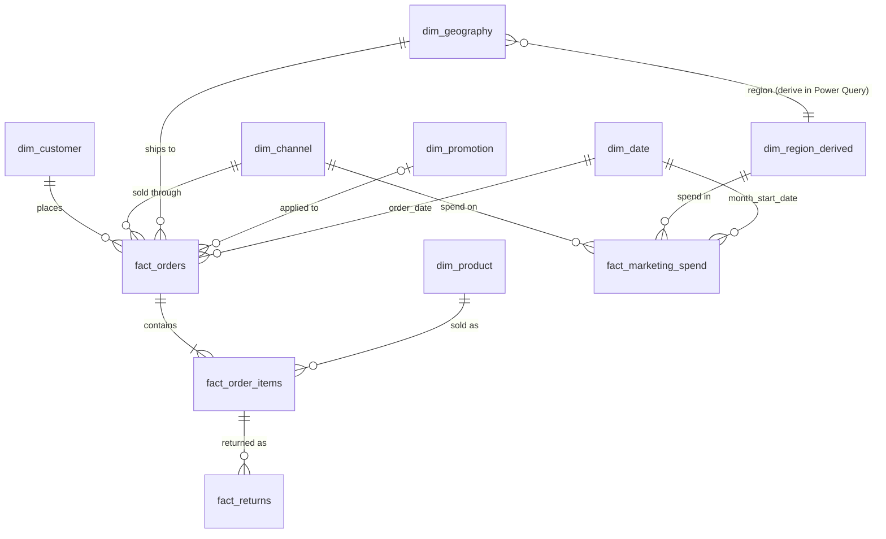

# Data Architecture and Data Dictionary

All data is synthetic. Files are in `data/raw/` and are intentionally imperfect. Row counts are in `documentation/validation_report.md`.

## 1. Model overview

Two sales facts and two supporting facts share conformed dimensions (date, channel, geography, customer, product, promotion).

| Table | Type | Grain (one row = …) | Purpose |
|---|---|---|---|
| `fact_orders` | Fact (header) | one customer order | Order timing, status, channel, ship-to, order-level shipping and fee amounts |
| `fact_order_items` | Fact (line) | one product on one order | Quantity, price, discount, cost, line revenue |
| `fact_returns` | Fact | one return of an order line (or part of it) | Refunds, return reasons, restocking, return freight |
| `fact_marketing_spend` | Fact | one month × channel × region | Marketing cost (Website, App, Marketplace advertising) |
| `dim_customer` | Dimension | one CRM customer record | Segment, country, sign-up date, acquisition source |
| `dim_product` | Dimension | one SKU | Category, brand, launch/discontinue, current price & cost, weight |
| `dim_channel` | Dimension | one sales channel | Fee rules |
| `dim_geography` | Dimension | one country (market) | Region, fulfilment hub, launch date |
| `dim_promotion` | Dimension | one promotion event | Type, dates, depth, scope |
| `dim_date` | Dimension | one calendar day, 2021-01-01 – 2026-12-31 | Calendar attributes. Starts in 2021 because legacy customers registered before 2023. |

**Conventions:** UTF-8, comma-delimited, header row, double-quote text qualifier, LF line ends, blank = NULL. Dates `YYYY-MM-DD`, timestamps `YYYY-MM-DD HH:MM:SS` (UTC). Money in USD with two decimals. Booleans `0/1` (or `Yes/No` where noted).
**Keys:** string surrogate keys (`ORD-000001`, `OI-000001`, `CUS-00001`, `PRD-001`, `PRM-001`, `RET-00001`, `MKT-0001`), integer keys for `channel_id` and `geography_id`.

## 2. Data dictionary

Nullable = Y means a NULL is legitimate in clean data. "Raw issues" are described in §6.

### fact_orders (PK `order_id`)
| Column | Type | Null | Description / rule |
|---|---|---|---|
| order_id | VARCHAR(20) | N | PK. `ORD-nnnnnn`, sequential by order timestamp |
| customer_id | VARCHAR(20) | N | FK → dim_customer |
| order_date | DATE | N | Reporting date = UTC date of `order_timestamp_utc` |
| order_timestamp_utc | DATETIME | N | When the order was placed (UTC) |
| channel_id | INT | N | FK → dim_channel. Wholesale only for Business customers; Mobile App only from 2023-07-01 |
| ship_geography_id | INT | N | FK → dim_geography. Market must be launched on `order_date` |
| promo_id | VARCHAR(20) | **Y** | FK → dim_promotion. NULL = no promotion. Order date must be inside the promo window and channel in scope |
| payment_method | VARCHAR(30) | N | Card, PayPal, Digital Wallet, Marketplace Payout, Invoice (Net 30), Bank Transfer |
| order_status | VARCHAR(20) | N | Delivered, Shipped, Processing, Cancelled (extract date 2026-01-05) |
| ship_date | DATE | **Y** | NULL for Cancelled and Processing. ≥ order_date |
| delivery_date | DATE | **Y** | NULL unless Delivered. ≥ ship_date |
| shipping_charged_usd | DECIMAL(10,2) | N | Shipping paid by the customer (0 = free shipping). 0 for Cancelled |
| shipping_cost_usd | DECIMAL(10,2) | N | Outbound carrier cost to TrailForge. 0 for Cancelled |
| channel_fee_usd | DECIMAL(10,2) | N | Marketplace: 15% × net merchandise revenue. Website/App: 2.9% × (net merchandise + shipping charged) + $0.30. Wholesale: 0. 0 for Cancelled |

### fact_order_items (PK `order_item_id`)
| Column | Type | Null | Description / rule |
|---|---|---|---|
| order_item_id | VARCHAR(20) | N | PK |
| order_id | VARCHAR(20) | N | FK → fact_orders. Each product appears at most once per order |
| product_id | VARCHAR(20) | N | FK → dim_product. Product must be launched and not discontinued on order date |
| quantity | INT | N | > 0 |
| unit_list_price_usd | DECIMAL(10,2) | N | List price on the order date (prices reviewed each January) |
| discount_pct | DECIMAL(5,2) | N | Fraction 0–1 (0.25 = 25%). Consumer: from the order's promotion (only in-scope categories); Wholesale: volume tier 20/25/30% (Electronics max 20%) |
| unit_cost_usd | DECIMAL(10,2) | N | Landed product cost per unit on the order date (constant within a month) |
| line_net_revenue_usd | DECIMAL(12,2) | N | `quantity × ROUND(unit_list_price × (1 − discount_pct), 2)` |

### fact_returns (PK `return_id`)
| Column | Type | Null | Description / rule |
|---|---|---|---|
| return_id | VARCHAR(20) | N | PK |
| order_item_id | VARCHAR(20) | N | FK → fact_order_items. Only Delivered orders can have returns |
| return_date | DATE | N | ≥ delivery_date; ≤ 2026-01-05 |
| return_quantity | INT | N | 1 … quantity ordered |
| return_reason | VARCHAR(30) | **Y** | Size or Fit, Not as Described, Changed Mind, Defective or Damaged, Arrived Late |
| refund_amount_usd | DECIMAL(12,2) | N | `return_quantity × unit net price`; Website/App "Changed Mind" returns retain a 10% restocking fee |
| restocked_flag | BIT | N | 1 = returned stock is resaleable (cost recovered); 0 = written off |
| return_shipping_cost_usd | DECIMAL(10,2) | N | Cost borne by TrailForge (0 when customer pays or Wholesale) |

### fact_marketing_spend (PK `marketing_spend_id`)
| Column | Type | Null | Description / rule |
|---|---|---|---|
| marketing_spend_id | VARCHAR(20) | N | PK |
| month_start_date | DATE | N | First day of month |
| channel_id | INT | N | FK → dim_channel (1, 2, 3 only; Wholesale has no marketing spend) |
| region | VARCHAR(30) | N | Matches `dim_geography.region`. Row exists only once the channel and ≥1 market in the region are live |
| spend_usd | DECIMAL(12,2) | N | Monthly spend. Unique on (month, channel, region) |

### dim_customer (PK `customer_id`)
| Column | Type | Null | Description / rule |
|---|---|---|---|
| customer_id | VARCHAR(20) | N | PK |
| customer_email | VARCHAR(100) | N | Synthetic (`@example.com` / `@example.net`). Natural key for de-duplication |
| customer_type | VARCHAR(10) | N | Consumer, Business |
| business_segment | VARCHAR(30) | **Y** | Specialty Retailer, Corporate / Organisation; NULL for consumers |
| country | VARCHAR(40) | N | Home country (free-text in CRM) |
| signup_date | DATE | N | Account creation. Legacy customers (132) registered 2021–2022; their earlier orders are not in the data |
| acquisition_source | VARCHAR(30) | N | Organic Search, Paid Social, Email Campaign, Referral, Direct, Marketplace, Wholesale Sales Team, Trade Show |
| marketing_opt_in | VARCHAR(3) | N | Yes / No |

### dim_product (PK `product_id`)
| Column | Type | Null | Description / rule |
|---|---|---|---|
| product_id, sku | VARCHAR | N | PK `PRD-001`…`PRD-060`; SKU unique |
| product_name, category, subcategory, brand | VARCHAR | N | Six categories; brands TrailForge (private label) and Voltrek (third-party electronics) |
| launch_date | DATE | N | Not saleable before this date (the 50 original SKUs show 2022-06-01) |
| discontinued_date | DATE | **Y** | NULL = still active; no sales after this date |
| list_price_usd | DECIMAL(10,2) | N | **Current** list price (at 2025-12-31, or at discontinuation). Historic prices are on the order line |
| standard_cost_usd | DECIMAL(10,2) | N | **Current** product cost; historic cost is on the order line |
| weight_kg | DECIMAL(6,2) | N | Unit weight, used for shipping allocation |

### dim_channel, dim_geography, dim_promotion, dim_date
| Table | Key columns and attributes |
|---|---|
| `dim_channel` (PK `channel_id` 1–4) | channel_name, channel_type (Direct / Marketplace / Wholesale), launch_date, fee_rate, fee_fixed_usd, fee_basis |
| `dim_geography` (PK `geography_id` 1–10) | country, iso_code, region (4), fulfilment_hub (3), utc_offset_hours, market_launch_date |
| `dim_promotion` (PK `promo_id`) | promo_name, promo_type (Clearance, Seasonal Sale, Black Friday, Flash Sale, Marketplace Deal, Free Shipping, Welcome Offer), start_date, end_date, discount_pct (0 for Free Shipping), channel_scope, category_scope (`All` or list), free_shipping_flag, first_order_only_flag |
| `dim_date` (PK `full_date`; `date_key` YYYYMMDD) | year, quarter, month_number, month_name, year_month, month_start_date, week_of_year, day_of_month, day_name, is_weekend, is_peak_season (Nov–Dec) |

## 3. Relationships

| From (many) | To (one) | Cardinality | Notes |
|---|---|---|---|
| fact_orders.customer_id | dim_customer | M:1 | Orphans exist in raw data |
| fact_orders.channel_id | dim_channel | M:1 | |
| fact_orders.ship_geography_id | dim_geography | M:1 | |
| fact_orders.promo_id | dim_promotion | M:1 (optional) | NULL = no promo |
| fact_orders.order_date | dim_date.full_date | M:1 | |
| fact_order_items.order_id | fact_orders | M:1 | Order-level amounts must not be summed across lines |
| fact_order_items.product_id | dim_product | M:1 | |
| fact_returns.order_item_id | fact_order_items | M:1 | |
| fact_marketing_spend.channel_id | dim_channel | M:1 | |
| fact_marketing_spend.region | region list from dim_geography | M:1 | derive a 4-row `dim_region` |
| fact_marketing_spend.month_start_date | dim_date.full_date | M:1 | month-level only |

## 4. Business rules (all enforced in the clean data; verified in the audit)

1. Currency is USD everywhere. Prices are USD list prices; international customers are billed the USD amount (no FX effects modeled).
2. List prices rise each January (2024: +4%, 2025: +3% on top, with category exceptions). Product costs change by year, with category-specific supplier increases in 2025.
3. Discounts come only from the promotion applied to the order (consumer channels) or from the wholesale tier. Promotions never stack; the deepest eligible promotion applies. A promotion only discounts in-scope categories.
4. Free shipping applies to Website/App orders at or above a country threshold ($75 US, $100 Canada, $120 UK/DE/FR, $150 elsewhere), on Free-Shipping promotions, and to Marketplace orders ≥ $35. Wholesale orders ≥ $1,500 ship free; below that, 6% of merchandise.
5. Cancelled orders keep their lines (for demand analysis) but have zero shipping, fees and no ship/delivery dates; they are **excluded from revenue**.
6. Returns exist only for Delivered orders, within the extract window.
7. `Delivered` = delivery date on or before 2026-01-05; `Shipped` = shipped, not yet delivered; `Processing` = not yet shipped.
8. Marketing spend rows exist only for months in which the channel and at least one market in the region are live.

## 5. Generation assumptions (how the data was created)

* One synthetic CRM of ~2,100 consumers and 40 business accounts. Consumer acquisition grows ~2× over 36 months with Nov–Dec and summer seasonality; Mobile App launches Jul-2023.
* Repeat purchasing follows a gamma-mixed Poisson process (some customers buy often, many once), with lower repeat propensity for Marketplace-acquired customers.
* Order timing, basket composition, promotion take-up, return propensity and shipping costs have realistic variation and customer-level heterogeneity; no single factor explains the margin outcome.
* Wholesale accounts order 3.5–8 times per year with weekday-only timestamps and seasonal buying.
* Order timestamps are UTC with local-hour demand patterns converted by country offset.
* Costs and prices reflect gross margins by category at list price that range from roughly 36% to 62%.
* Data was generated with a fixed random seed (`generator/generate_dataset.py`) for reproducibility.

## 6. Documented data-quality issues (raw files)

Issues are intentional, detectable and recoverable, except where stated. Exact row locations are deliberately not disclosed; counts are in `validation_report.md`.

| # | Table | Issue type | Suggested handling |
|---|---|---|---|
| 1 | fact_orders, order_items, returns, marketing | Exact duplicate rows (duplicate primary keys) | De-duplicate on key |
| 2 | fact_orders | Orders referencing customer IDs that do not exist | Keep revenue; map to an "Unknown customer" member |
| 3 | fact_orders | Inconsistent status labels (case, spaces, synonyms like "Completed", "canceled", "In Transit") | Map to four canonical values |
| 4 | fact_orders | `order_date` in `DD-Mon-YYYY` text format; a few set to 2026 (typo) | Parse; use `order_timestamp_utc` as the authoritative date |
| 5 | fact_orders | Ship date before order date; delivery before ship; cancelled orders with ship/delivery dates; delivered orders with no delivery date | Flag; null impossible dates; do not guess |
| 6 | fact_orders | Missing and negative `shipping_cost_usd` | ABS() for sign error; impute group average (flagged) |
| 7 | dim_customer | Duplicate customers (same e-mail in different case, different ID); orders split across the two IDs | Merge on normalised e-mail |
| 8 | dim_customer | Country label variants (USA/US/UK/Deutschland/UAE …), missing country, missing e-mail, type label variants, mixed date formats | Mapping table; impute country from orders |
| 9 | dim_customer | 25 customers whose account was created *after* their first order (guest checkout) | Use first order date for cohorts; not an error to "fix" |
| 10 | dim_product | Category label variants; missing weight | Standardise; impute from sub-category |
| 11 | fact_order_items | Discount stored as whole percent (15 instead of 0.15) | Divide by 100 |
| 12 | fact_order_items | Negative quantity | ABS(); revenue was positive |
| 13 | fact_order_items | Missing unit cost; zero list price; list price ×10 (decimal slip) | Recover from the product's price/cost in the same year/month |
| 14 | fact_order_items | Line revenue not equal to quantity × net price | Recompute from components |
| 15 | fact_order_items | Product IDs without zero padding (`PRD-7`); retired SKUs not in catalogue; lines whose order does not exist | Re-pad; map to "Unknown product"; reject orphan lines |
| 16 | fact_returns | Return before delivery; return quantity > ordered; refund > line revenue | Flag; cap quantity and refund |
| 17 | fact_returns | Missing and inconsistent reason labels; returns on cancelled orders; returns for non-existent items | Standardise; "Unknown"; reject |
| 18 | fact_marketing_spend | Missing spend values; one duplicated row | Interpolate neighbours (flagged); de-duplicate |
| 19 | all facts | Intentional business context, not errors: legacy customers (pre-2023 registration), NULL promo = no promotion, wholesale quantities of 4–24 per line | Do not treat as errors |

## 7. Files and reproducibility

`generator/generate_dataset.py` recreates the data from seed `20260105`; `generator/audit_dataset.py` re-runs every consistency check against the delivered CSVs. Reading the generator before doing the analysis would reveal how the business behaviour was parameterised; keep it out of the public repo until your analysis is finished, or accept the spoiler.
